# **Active Directory Security Home Lab**

### **Windows Server 2022 \| Splunk SIEM \| Sysmon \| Kali Linux \| Atomic Red Team**

**Project Type:** Cybersecurity, Systems Administration, Networking, Security Monitoring, and Adversary Simulation

**Environment:** Virtualized home lab using Oracle VirtualBox

**Project Status:** Core lab implementation and security-monitoring exercises completed. Crowbar credential-success detection remains unresolved.

**Project Period:** November 2026

**Author:** Darryl Brown Jr. [<u>https://github.com/iadjbro4</u>](https://github.com/iadjbro4)

## **Executive Summary**

I designed and implemented a virtualized Active Directory home lab to develop practical experience with Windows Server administration, enterprise networking and configuration, domain authentication, security event collection, adversary activity monitoring, and troubleshooting.

The lab integrates four primary virtual machines:

- Windows Server 2022 is the Active Directory domain controller and DNS server.

- Windows 10 Pro is the domain-joined workstation and test target for security testing.

- Ubuntu Server hosts Splunk Enterprise for security logging and investigation.

- Kali Linux serves as the attack-simulation and security-testing workstation.

The environment operates on a shared VirtualBox NAT Network, allowing the machines to communicate while remaining part of a controlled testing environment.

I configured Active Directory Domain Services (AD/DS), created domain user accounts, joined a Windows 10 Pro workstation to the domain, established Remote Desktop connectivity, installed Sysmon and Splunk Universal Forwarder, and integrated Windows endpoint telemetry with Splunk Enterprise. To validate the environment, I performed controlled RDP authentication testing from Kali Linux and analyzed successful and failed Windows authentication events in Splunk. I also used Atomic Red Team to simulate MITRE ATT&CK technique T1136.001 which creates a local account on the Windows 10 Pro workstation. Splunk successfully recorded the creation and deletion of the account from the attack. The project also required substantial troubleshooting of virtual networking, Windows services, Remote Desktop listener initialization, domain time synchronization, Splunk event forwarding, and offensive-tool compatibility. The outcome was a functioning Active Directory and endpoint-monitoring lab that demonstrated both system administration and cybersecurity investigation skills.  
  
This project was adapted from the [<u>Active Directory Project by avulman</u>](https://github.com/avulman/active-directory-project), with additional documentation covering my implementation, troubleshooting, and observed security-monitoring results.

## **Project Objectives**

My primary goal was to gain hands-on experience implementing, managing, and monitoring a small enterprise-style IT environment.

The technical objectives were to:

1.  Deploy multiple operating systems using Oracle VirtualBox.

2.  Configure a virtual network that supports communication between all lab machines.

3.  Install and configure Windows Server 2022 with AD/DS.

4.  Create organizational units and domain user accounts.

5.  Join a Windows 10 Pro workstation to the Active Directory domain.

6.  Configure domain authentication, DNS resolution, and Remote Desktop access.

7.  Deploy Splunk Enterprise as a centralized security monitoring platform.

8.  Install and configure Splunk Universal Forwarder and Sysmon.

9.  Collect and analyze Windows Security, System, and Sysmon events.

10. Simulate authentication activity from Kali Linux.

11. Identify Windows authentication events associated with remote access attempts.

12. Execute an Atomic Red Team technique and determine whether Splunk detects the generated activity.

13. Investigate technical failures and document the troubleshooting methodology.

14. Develop a foundation for future homelab projects.

## **Technologies and Tools**

| **Technology**                   | **Purpose**                                            |
|----------------------------------|--------------------------------------------------------|
| Oracle VirtualBox                | Virtual machine hosting and network isolation          |
| Windows Server 2022              | Active Directory domain controller                     |
| Active Directory Domain Services | Centralized identity and domain management             |
| Active Directory DNS             | Domain controller discovery and hostname resolution    |
| Windows 10 Pro                   | Domain-joined endpoint and security-testing target     |
| Ubuntu Server                    | Linux host for Splunk Enterprise                       |
| Splunk Enterprise 10.6.1         | Centralized log searching and investigation            |
| Splunk Universal Forwarder       | Windows log collection and forwarding                  |
| Sysmon                           | Windows endpoint telemetry                             |
| Kali Linux                       | Security-testing workstation                           |
| Crowbar 4.2                      | Controlled RDP password-testing exercise               |
| FreeRDP 3.31.1                   | Remote Desktop connectivity and authentication testing |
| Atomic Red Team                  | MITRE ATT&CK-aligned security testing                  |
| PowerShell                       | System administration and diagnostics                  |
| Windows Event Viewer             | Local security-event investigation                     |

## **Lab Architecture**

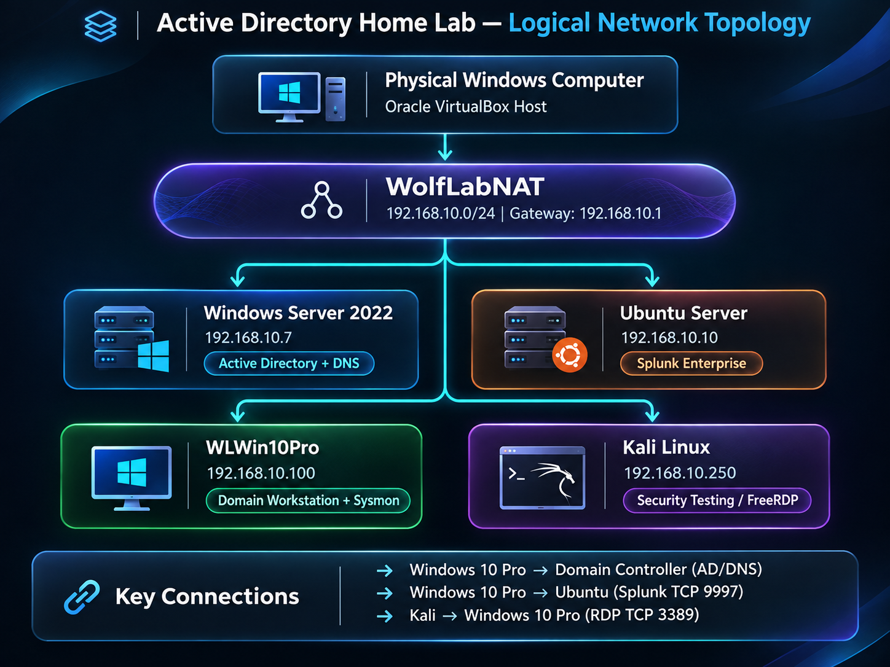

### **Virtual machines and network configuration**

I created a shared VirtualBox NAT Network named WolfLabNAT, using the 192.168.10.0/24 network. The Windows Server domain controller and Ubuntu Splunk server used stable addresses to ensure that domain DNS and log-forwarding destinations remained consistent.

| **<u>Virtual Machine</u>** | **<u>Operating System</u>** | **<u>IP Address</u>** | **<u>Role</u>**             |
|----------------------------|-----------------------------|-----------------------|-----------------------------|
| Domain Controller          | Windows Server 2022         | 192.168.10.7          | Active Directory and DNS    |
| Splunk Server              | Ubuntu Server               | 192.168.10.10         | SIEM and log indexing       |
| Target Workstation         | Windows 10 Pro              | 192.168.10.100        | Domain workstation          |
| Security Workstation       | Kali Linux                  | 192.168.10.250        | Authorized security testing |
| Virtual Gateway            | VirtualBox NAT Network      | 192.168.10.1          | Virtual network gateway     |

**Network:** 192.168.10.0/24

**Domain:** demodomain.local

**Domain Controller:** WolfLab.demodomain.local

**Windows Workstation:** WLWin10Pro

**Splunk Web Interface:** [<u>http://192.168.10.10:8000</u>](http://192.168.10.10:8000)

**Splunk Receiving Port:** TCP 9997

**Remote Desktop Port:** TCP 3389

**<u>These addresses represent the configuration of my isolated learning environment, not a public production network.</u>**

## **Virtual Machine Deployment**

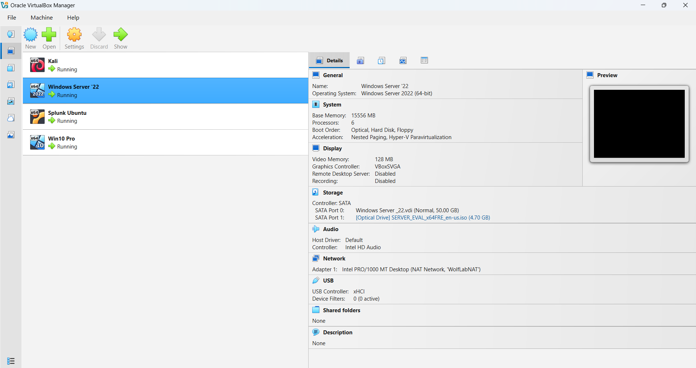

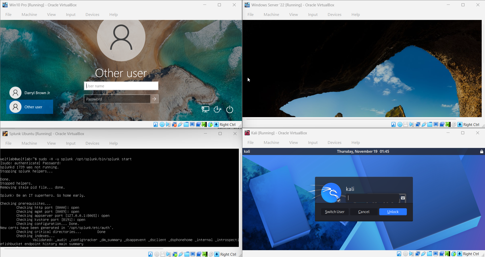

## **Active Directory Configuration**

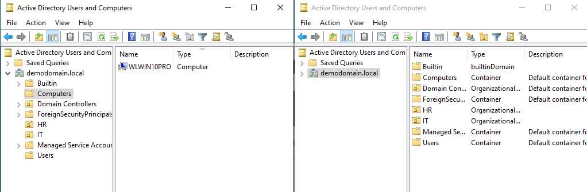

A part of configuring the Active Directory and local domain was the creation of two organizational units, HR and IT, each representing pseudo-departments in the virtual enterprise. I then created a user for each department (HR: John Doe; IT: Jenny Smith) to test for domain authentication and access, practice account location, review account properties, investigate account-lockouts, and account recovery/password resets.

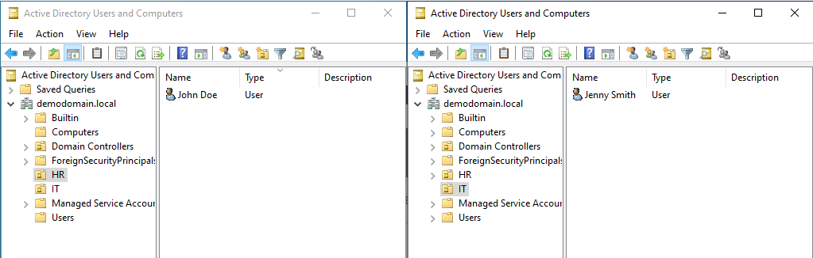

### **Domain-joining Windows 10 Pro**

I configured the Windows 10 Pro workstation to use the domain controller at 192.168.10.7 for DNS and joined WLWin10Pro to demodomain.local. The screenshot below confirms that the Windows 10 Pro workstation joined the domain.

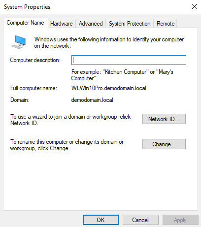

## **Splunk Enterprise Deployment**

### **Splunk server configuration**

Installed Splunk Enterprise on the Ubuntu Server VM then created a dedicated ‘endpoint’ index to organize and analyze Windows Security, System, and Sysmon events collected from the domain-joined workstation.  
  
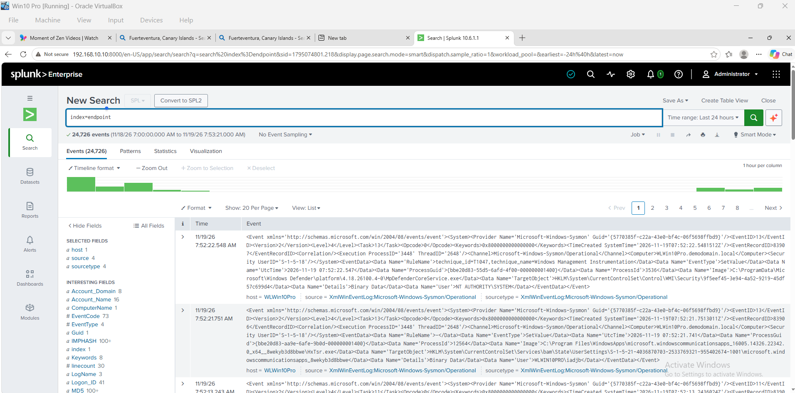

### **Starting Splunk**

The command used to start Splunk under its dedicated Linux service account is **sudo -H -u splunk /opt/splunk/bin/splunk start** and the command to check the running status of the Splunk service is **sudo -H -u splunk /opt/splunk/bin/splunk status.** (The picture below shows the results of when Splunk is already running; it will prompt you to authenticate the startup request upon first login/request).

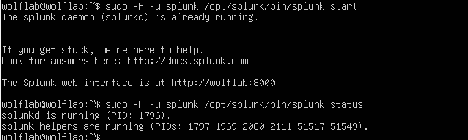

### **Windows log collection**

I installed and configured Splunk Universal Forwarder on the Windows 10 Pro workstation to collect Windows Security, System, and Sysmon event logs. The forwarder transmitted these events to Splunk Enterprise for centralized indexing and security analysis.

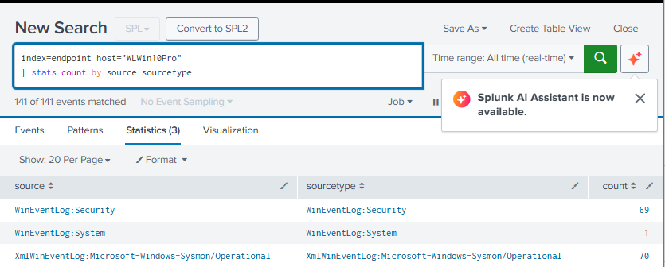

The Sysmon used in the lab worked with a custom XML configuration that allowed Windows endpoint activity to be collected through the Sysmon Operational event channel and forwarded to Splunk. Through the various troubleshooting processes regarding Splunk (see Troubleshooting) I learned to check for successful log ingestion through verifying service status, network/port connectivity, forwarding destination configuration, Windows Event inputs, and index availability.

## **Remote Desktop and Authentication Testing**

### **Remote Desktop configuration**

I enabled Remote Desktop on Windows 10 Pro and granted authorized domain accounts permission to connect through the created user ‘Jenny Smith’. This was an authorized RDP connectivity test used to verify remote authentication independently of the Crowbar password-testing results.

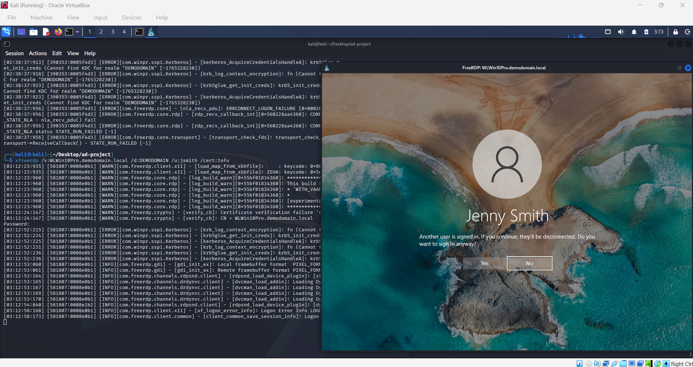

## **Controlled RDP Authentication Testing with Kali Linux**

### **Objective and Testing**

I conducted controlled RDP authentication testing from Kali Linux (192.168.10.250) against the Windows 10 Pro workstation (192.168.10.100) using a dedicated Active Directory test account. The objective was to generate authentication activity and verify whether Windows recorded the resulting events for analysis in Splunk.

I used Crowbar 4.2 with a small password list to test RDP authentication. Although the tool processed the supplied credentials, it consistently returned ‘No results found’, even when a valid password was included. I independently verified successful RDP authentication using FreeRDP 3.31.1.

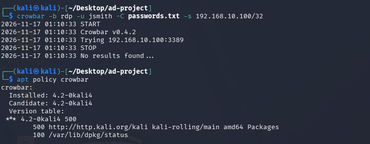

Further investigation suggested a possible compatibility issue between Crowbar's success-detection logic and FreeRDP's authentication output, but the exact cause remained unconfirmed.

### **Results and Findings**

Crowbar did not successfully identify valid credentials during testing. However, I confirmed functional RDP authentication, observed Windows authentication events, and verified failed-logon telemetry in Splunk. This exercise demonstrated the importance of independently validating security-testing results through authentication logs and SIEM telemetry rather than relying solely on a tool's reported outcome.

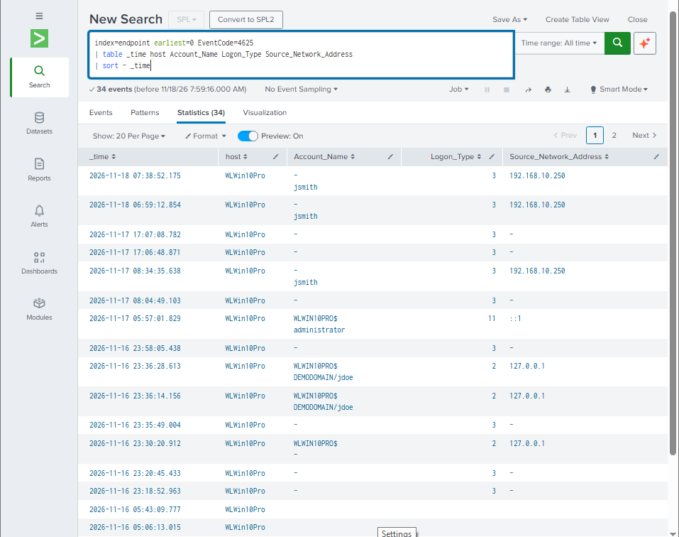

## **Windows Authentication Event Analysis in Splunk**

### **Authentication Event Investigation**

I used Splunk Enterprise to investigate successful and failed authentication activity recorded by the Windows 10 Pro workstation. Windows Event ID 4624 with Logon Type 10 confirmed successful remote interactive authentication involving the jsmith test account, while Event ID 4625 identified failed authentication attempts.

I queried failed logons using:

```spl
index=endpoint earliest=0 host="WLWin10Pro" EventCode=4625
```

The results included authentication failures associated with Kali Linux (192.168.10.250), as well as events containing loopback or unspecified source addresses. These findings demonstrated the importance of examining individual event attributes rather than attributing all authentication failures to the security-testing workstation.

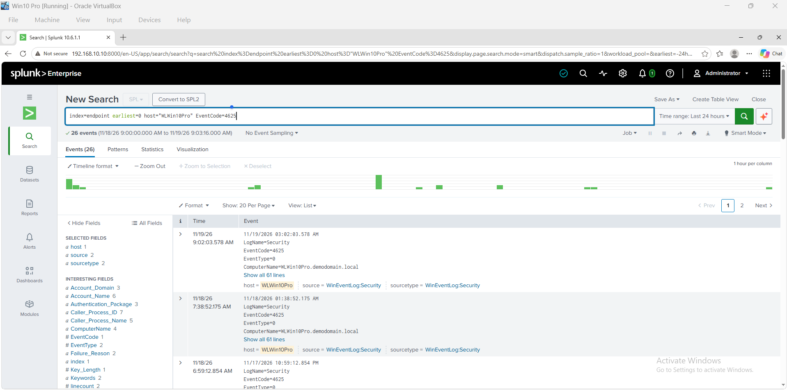

### **Failed-Logon Detection Analysis**

I grouped Event ID 4625 records into five-minute intervals to evaluate a detection threshold of five failed logons within five minutes.

The analysis returned 16 failed-logon events across 14 five-minute groups, with a maximum of two failures in any group. Consequently, the configured threshold produced no matches.

This demonstrated that Windows authentication telemetry was successfully collected and analyzed, but the observed activity did not satisfy the conditions required to trigger the high-frequency detection rule.

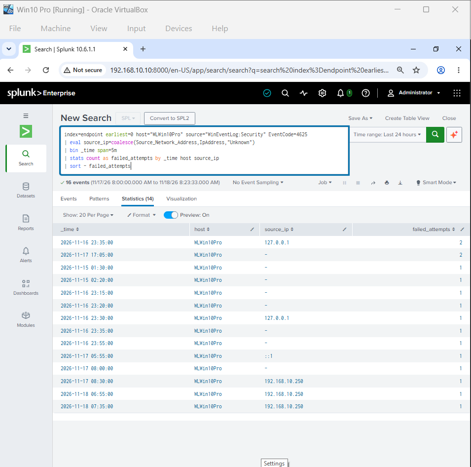

## **MITRE ATT&CK Simulation and Detection with Atomic Red Team**

### **Test Execution**

I executed Atomic Red Team technique **T1136.001 — Create Account: Local Account** on Windows 10 Pro to simulate security-relevant account creation and evaluate Splunk's ability to detect the activity.

The PowerShell-based tests produced mixed results: several account-creation methods succeeded, while others encountered password-policy restrictions or execution errors. These limitations are documented in *Troubleshooting Case Studies*.

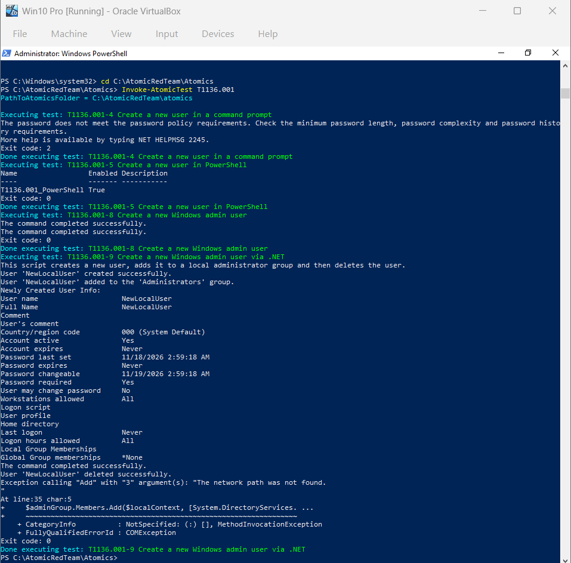

### **Detection Results**

I investigated the resulting Windows account-management events in Splunk. The search returned eight matching events, including confirmed account creation (Event ID 4720) and deletion (Event ID 4726) associated with the test account NewLocalUser.

Although Event ID 4732 was included in the search, a separate group-membership addition event was not confirmed.

The results demonstrated that Splunk successfully collected and displayed Windows account-management activity generated during the MITRE ATT&CK-aligned simulation, providing visibility into behavior associated with technique T1136.001.

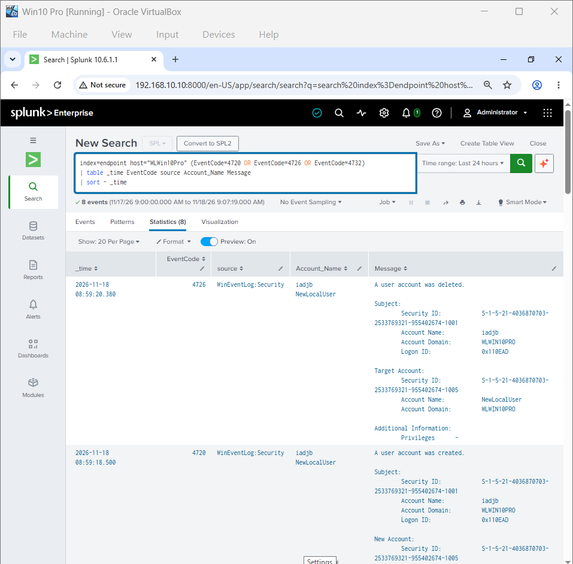

## **Troubleshooting Case Studies**

#### **Windows 10 Home Domain-Join Compatibility**

During the initial deployment, I discovered that Windows 10 Home does not support joining a traditional Active Directory domain. After identifying this operating system limitation, I deployed a Windows 10 Pro virtual machine named WLWin10Pro, configured its DNS settings to use the domain controller, and successfully joined it to demodomain.local. This reinforced the importance of verifying operating system compatibility with infrastructure requirements before deployment.

#### **VirtualBox DHCP and Network Addressing Configuration**

During the initial VirtualBox network setup, I discovered that the DHCP server address (10.0.2.2) did not align with the intended 192.168.10.0/24 subnet. After reviewing the NAT Network configuration, I corrected the DHCP server address to 192.168.10.2 and configured the allocation range from 192.168.10.100 to 192.168.10.200, retaining 192.168.10.1 as the default gateway. Subsequent connectivity testing confirmed that Kali Linux could reach the Windows workstation over TCP port 3389. This experience reinforced the importance of consistent addressing and validating network configuration at both the hypervisor and guest operating system levels.

#### **Kali Linux IP Address and RDP Connectivity**

During RDP authentication testing, Kali Linux could not connect to the Windows 10 Pro workstation because its IP address was incorrectly configured as 198.162.10.250/24 instead of 192.168.10.250/24. I identified the addressing issue by examining the network interface, routing table, and connectivity using the following commands:

**ip -4 addr  
ip route  
ping 192.168.10.100  
nc -nvz -w 5 192.168.10.100 3389**

After correcting Kali's IP address and confirming the default gateway, the TCP test showed that port 3389 was reachable. Although ICMP ping continued to fail, RDP connectivity worked, reinforcing the importance of testing individual network protocols rather than relying solely on ping.

#### **RDP Listener Initialization Failure – Error 0x80070005**

During RDP testing, Windows 10 Pro was not accepting remote connections even though Remote Desktop Services was running. I investigated service status, TCP listeners, and Windows event logs using:

**Get-Service TermService**

**Get-Service UmRdpService**

**Get-NetTCPConnection -LocalPort 3389 -State Listen**

**qwinsta**

**Get-WinEvent**

Windows recorded an initialization failure with error 0x80070005, and the SelfSignedCertStore registry value was missing or blank. After backing up the relevant registry configuration, I set the value to Remote Desktop and restarted Windows. Subsequent checks confirmed that the rdp-tcp listener was active and TCP port 3389 was listening on IPv4 and IPv6. This demonstrated that a running Windows service does not necessarily indicate a functioning network listener. The certificate-store setting was a likely contributor, although the precise underlying cause was not conclusively established.

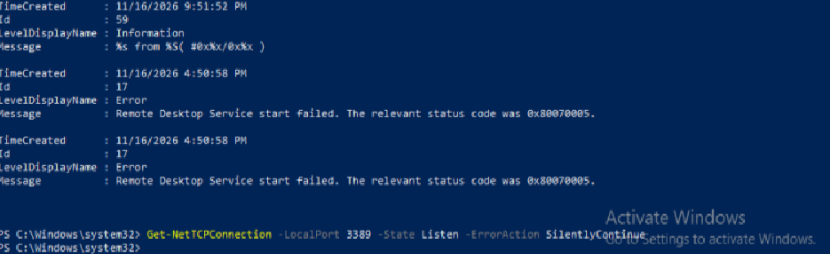

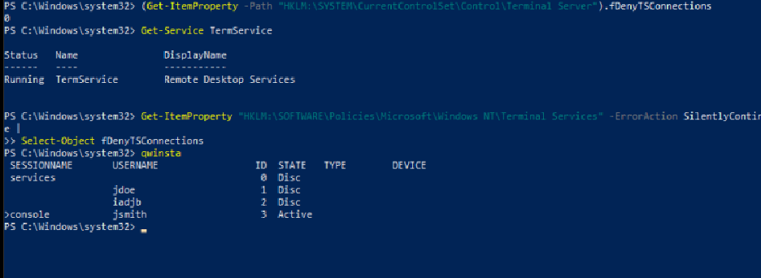

#### **Sysmon XML Configuration File Not Found**

During Sysmon installation, Windows could not open the specified XML configuration file. I investigated the file location and the path referenced by the installation command, identifying a configuration-path issue. After correcting the file reference, Sysmon telemetry became available in Splunk under the following source:

**XmlWinEventLog:Microsoft-Windows-Sysmon/Operational**

This reinforced the importance of checking file paths and installation prerequisites before assuming that a service or application has failed.

#### **Splunk Universal Forwarder Startup Failure**

While configuring Windows event forwarding, Splunk Universal Forwarder encountered Windows service error 1053, indicating that the service had not responded within the expected time. I reviewed its service status, configuration, and forwarding destination, eventually restoring operation, although the precise cause of the startup failure was not conclusively established.

I verified successful event ingestion using:

**index=endpoint host="WLWin10Pro"  
\| stats count by source sourcetype**

The results confirmed that Windows Security, System, and Sysmon telemetry were reaching Splunk. This demonstrated why successful data ingestion is a more meaningful verification than checking service status alone.

#### **Windows Security Events Missing from Splunk**

During authentication testing, Windows recorded security events locally, but the Security event channel was initially missing from Splunk's indexed results. I investigated the Universal Forwarder inputs and compared the collected event sources using:

**index=endpoint host="WLWin10Pro"  
\| stats count by source sourcetype**

After correcting and verifying Security event collection, Splunk displayed Windows Security, System, and Sysmon events. I further confirmed failed-logon visibility using:

**index=endpoint earliest=0 host="WLWin10Pro" EventCode=4625**

This demonstrated the importance of verifying individual event channels rather than assuming that successful forwarding of some logs guarantees complete telemetry collection.

#### **Active Directory Domain Time Synchronization Failure**

During authentication troubleshooting, I discovered an approximately 17-hour clock discrepancy between Windows 10 Pro and the domain controller. I investigated the system clocks, time sources, and domain time hierarchy using:

**Get-Date  
Get-TimeZone  
w32tm /query /status  
w32tm /query /source  
w32tm /stripchart /computer:192.168.10.7 /samples:5 /dataonly**

The domain controller initially reported Local CMOS Clock as its time source. After confirming that it held the PDC emulator role, I corrected its time configuration to use time.windows.com and worked to synchronize the workstation through the domain hierarchy. This demonstrated the importance of accurate time synchronization for domain authentication and reliable security-event correlation.

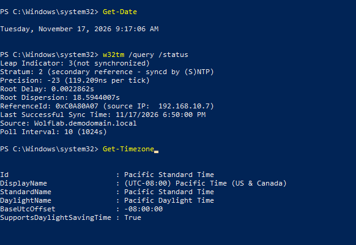

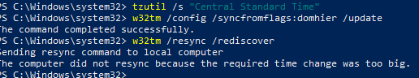

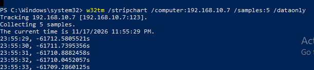

#### **Crowbar and FreeRDP Authentication Testing Limitation**

During controlled RDP password testing, Crowbar 4.2 repeatedly returned No results found, even when the test password list contained valid credentials. I verified network connectivity, RDP availability, domain account status, and successful authentication independently using FreeRDP 3.31.1.

I also inspected Crowbar's authentication-result detection logic using:

**grep -n "Authentication only, exit status" /usr/share/crowbar/lib/[<u>main.py</u>](http://main.py)**

The source code expected the message Authentication only, exit status 0, suggesting a possible compatibility issue with FreeRDP's output. However, the exact cause was not proven, and Crowbar remained unresolved. This investigation reinforced the importance of independently validating security-tool results and accurately documenting unsuccessful outcomes.

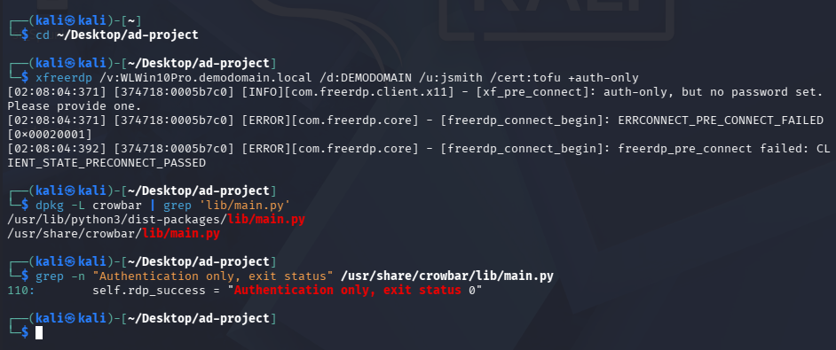

#### **Atomic Red Team Account-Creation Test Failures**

During Atomic Red Team technique T1136.001, several local account-creation tests succeeded, while others encountered Windows password-policy restrictions or execution errors. A .NET-based test reported The network path was not found, demonstrating that a reported exit code does not necessarily confirm successful execution.

I verified the successful account-management activity in Splunk, where Event ID 4720 confirmed creation of the NewLocalUser account and Event ID 4726 confirmed its deletion. Although Event ID 4732 was included in the search, a separate group-addition event was not confirmed. This exercise demonstrated the importance of validating simulation results against Windows event telemetry rather than relying solely on automated test output.

#### **Splunk Failed-Logon Detection Threshold** 

During Windows authentication analysis, a Splunk detection query requiring five failed logons within five minutes returned no matches. I verified that failed authentication events were being collected using the following search:

**index=endpoint earliest=0 host="WLWin10Pro" EventCode=4625**

I then grouped the events into five-minute intervals to investigate their frequency:

**index=endpoint earliest=0 host="WLWin10Pro" source="WinEventLog:Security" EventCode=4625  
\| eval source_ip=coalesce(Source_Network_Address,IpAddress,"Unknown")  
\| bin \_time span=5m  
\| stats count as failed_attempts by \_time host source_ip  
\| sort - failed_attempts**

The analysis identified 16 failed-logon events across 14 groups, with a maximum of two failures per group. Since the observed activity did not meet the five-failure threshold, the detection correctly returned no matches. This reinforced the importance of validating event data and detection conditions before interpreting an empty search result as a logging failure.

## **Key Technical Discoveries**

Throughout this project, I learned the importance of troubleshooting systems at multiple levels. A running service doesn’t guarantee network availability, as demonstrated by the RDP listener failure. I also gained a better understanding of how IP addressing, routing, DNS, and time synchronization affect network connectivity and Active Directory authentication.

My Splunk investigations reinforced the importance of verifying individual event sources and interpreting authentication activity within its proper context. I learned that detection rules may produce no results when activity falls below a defined threshold, even when logging is functioning correctly.

Finally, testing with Crowbar and Atomic Red Team demonstrated the limitations of security-testing tools and the importance of independently validating their results. Both successful and unsuccessful tests provided valuable insights into Windows security behavior, event monitoring, and systematic troubleshooting.

## **Security Considerations**

All attack simulations were conducted against virtual machines and test accounts under my control. The environment was designed for learning and validation rather than testing external or third-party systems. I avoided treating simulated attack traffic as evidence of a real compromise.

The repository will not include:

- Active Directory account passwords.

- Password-list contents containing real credentials.

- Splunk administrator credentials.

- Private keys or certificates.

- Authentication tokens.

- Sensitive configuration secrets.

Configuration examples and screenshots will be reviewed before publication to ensure that credentials and other unnecessary sensitive information are excluded.

## **Project Scope and Limitations**

This home lab provided hands-on experience in systems administration, networking, security monitoring, and troubleshooting. I configured Active Directory and Windows services, managed virtual networking and domain connectivity, deployed Splunk and Sysmon for centralized event collection, and analyzed authentication and account-management activity. Throughout the project, I strengthened my ability to diagnose and resolve technical issues across Windows, Linux, virtualization, and security tools.

This project was conducted in an isolated virtual lab intended for hands-on learning and controlled security testing. While it demonstrates practical experience with Active Directory administration, network configuration, security monitoring, and event analysis, it does not represent a production-hardened enterprise environment or comprehensive security detection coverage.

## **Final Reflection**

This project strengthened my practical understanding of Active Directory administration, networking, and security monitoring. Through hands-on configuration, troubleshooting, and controlled security testing, I developed a more systematic approach to diagnosing technical issues and validating results. The completed environment demonstrated functional domain authentication, remote connectivity, centralized security logging, and detection of simulated security-relevant activity.

## **Acknowledgments**

This home lab was built using the [<u>Active Directory Project by avulman</u>](https://github.com/avulman/active-directory-project) as the foundational tutorial.

The original project provided the general lab architecture and instructional framework for configuring Active Directory, Splunk, Sysmon, Kali Linux, and Atomic Red Team in a virtualized environment.

My implementation follows that foundational design while documenting my own virtual machine configurations, network topology, troubleshooting experiences, security tests, Splunk investigations, and technical findings.

Notable additions to my documentation include:

- Troubleshooting VirtualBox IP addressing and network connectivity.

- Diagnosing and resolving Windows Remote Desktop listener initialization failures.

- Investigating Active Directory time synchronization issues.

- Troubleshooting Splunk Universal Forwarder and Windows Security event collection.

- Investigating Crowbar and FreeRDP authentication compatibility.

- Analyzing authentication failures and Atomic Red Team activity in Splunk.

**Original project:** [<u>avulman/active-directory-project</u>](https://github.com/avulman/active-directory-project)

**Implementation, troubleshooting, network diagram, screenshots, and analysis:** [<u>iadjbro4</u>](https://github.com/iadjbro4)
